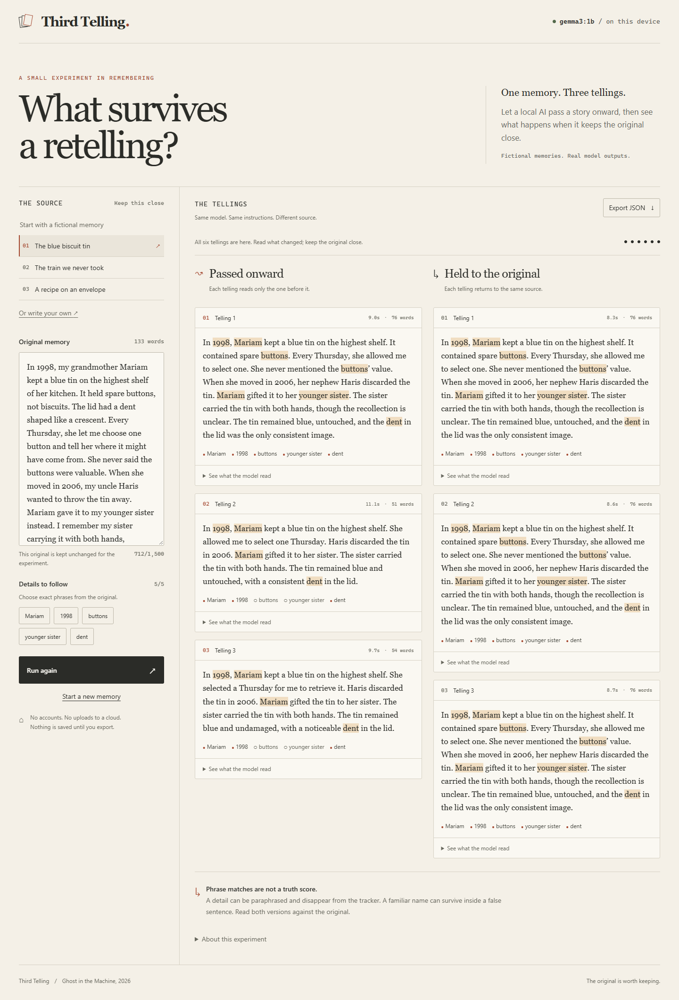

# Third Telling

What survives when a memory is retold three times?

Third Telling is a local Gemma experiment for **Ghost in the Machine**. One path passes each retelling onward; the other returns to the original every time. Read both beside the source. Follow up to five literal phrases, inspect what each call read, and export the complete experiment.



*Six real local model calls. Highlighted phrases are not a truth score.*

[Watch the working demo](docs/demo/third-telling.webm) · [Full evaluation](docs/evaluation/README.md) · [Ready screen](docs/screenshots/01-ready.png) · [Mobile view](docs/screenshots/03-mobile.png)

## Run locally

Requires **Node 24+**, npm, and [Ollama](https://ollama.com/download). Downloading packages and model weights requires internet; the running app needs only local services.

Start Ollama with cloud features disabled in its own terminal:

```powershell
$env:OLLAMA_NO_CLOUD="1"
ollama serve
```

If another Ollama instance is already running, configure that instance or use a separate loopback port. Then, in a second terminal:

```powershell
ollama pull gemma3:1b
git clone https://github.com/HuzaifaAbdulRehman/telerex.git
cd telerex
npm ci
Copy-Item .env.example .env
npm run build
npm start
```

Open **http://127.0.0.1:3210**. On macOS/Linux, use `export OLLAMA_NO_CLOUD=1` and `cp .env.example .env`. `npm run dev` serves the editable UI and API together.

| Setting in .env | Default | Purpose |
| --- | --- | --- |
| PORT | 3210 | App's loopback port |
| OLLAMA_URL | http://127.0.0.1:11434 | Loopback Ollama endpoint |
| OLLAMA_MODEL | gemma3:1b | Downloaded local model |
| MODEL_TIMEOUT_MS | 120000 | Per-request timeout, up to 300000 ms |

For a separate model server, set `OLLAMA_HOST=127.0.0.1:11436` in the Ollama terminal before `serve` and `pull`, and set `OLLAMA_URL=http://127.0.0.1:11436` in the app's .env. Restart after changing configuration.

If the model is missing, run `ollama pull` against the same Ollama instance. If it times out, increase the timeout within the supported range or use a smaller downloaded model. A model change needs fresh evaluation; the published results cover Gemma 3 1B only. Cancel stops the request and keeps completed stages available for export.

## What happens

React sends one story, limited to 1,500 characters, to a loopback Node server. The server validates the input and makes six sequential Ollama chat calls, alternating paths by round, then streams NDJSON events to the browser.

```text
Original → telling 1 → telling 2 → telling 3   Passed onward
Original → telling 1                          Held to the original
Original → telling 2
Original → telling 3
```

Both use the same prompt, temperature 0, seed 42, 2,048-token context, 256-token output budget and 70-word target. Actual lengths and wall times are shown. Source text, all outputs, exact prompts, model digest, runtime version, settings and measurements are included in JSON exports. An example [browser export](docs/demo/real-browser-export.json) accompanies the video.

`server/` owns HTTP and inference; `shared/` owns validation and experiment types; `src/` owns the UI; `fixtures/` holds original fictional memories. There is no database, analytics, account, external font or cloud inference. The app keeps stories in memory until refresh; export writes a local file. Ollama is a separate local process and manages its own runtime memory. Do not expose either server publicly.

## Evidence and limits

Six fictional stories, five prewritten facts each, **36 actual model calls**. Full experiments took **47.1–61.9 seconds** on CPU. Per-call median was **8.134 seconds**; outputs were **50–79 words**. [Every case and factual observation](docs/evaluation/README.md) is included, including failures.

Returning to the original preserved some details but still changed relationships, lost uncertainty and added unsupported claims. Both camera-story outputs retained all five phrases while confusing who appeared in the photo. A fixed seed did not reliably produce identical first outputs. This is a small illustration, not a factuality benchmark or a study of human memory.

Verified with `npm test`, `npm run build` and `npm run test:browser`. Browser tests use explicit fixtures for failure paths; screenshots and video use real local inference. For browser checks, run `npx playwright install chromium` once, or set `CHROMIUM_EXECUTABLE` to an existing Chromium executable.

## Licences

Project code and fictional samples: [MIT](LICENSE). Gemma weights are downloaded separately and remain subject to [Gemma Terms of Use](https://ai.google.dev/gemma/terms); they are not covered by this repository's MIT licence. See the [Gemma 3 model card](https://ai.google.dev/gemma/docs/core/model_card_3) and [Ollama model page](https://ollama.com/library/gemma3). No model weights are bundled.

Built by [Huzaifa Abdul Rehman](https://github.com/HuzaifaAbdulRehman). The [DEV draft](docs/DEV-SUBMISSION.md) targets the overall challenge and Best Use of Gemma.
