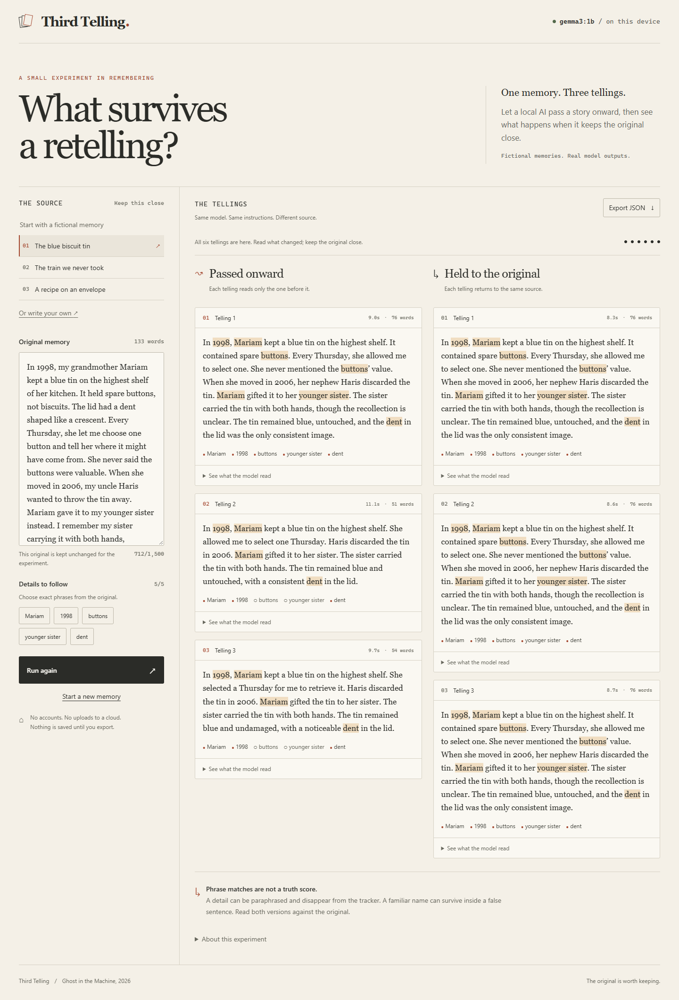

*This is a submission for the [Hacktoberfest Open-Source AI Challenge Week 4: Ghost in the Machine](https://dev.to/challenges/hacktoberfest-week4-2026-10-26).*

## What I Built

In one fictional memory, Sami takes a photograph of his older brother Adil. Three retellings later, the model puts both brothers inside the photograph. Every phrase I was tracking survives.

That is the ghost I wanted to make visible: a story can keep its familiar names while losing the relationships that made it true.

**Telerex** runs two paths through local Gemma. One retelling reads the one before it. The other reads the original every time. Each path has three tellings, shown beside the unchanged source. You can start with one of three fictional memories or write your own short story, choose five phrases to follow, and export the full record.

This fits the theme through the traces a memory leaves behind. It does not impersonate a dead relative or claim to recover a real memory. Every public example is fictional.

## Demo

[Watch the working local demo](https://github.com/HuzaifaAbdulRehman/telerex/blob/main/docs/demo/third-telling.webm).

The video records real inference and the JSON export. This is a local application, so there is no hosted chat service. Setup instructions are in the repository.

## Code



[Source and setup](https://github.com/HuzaifaAbdulRehman/telerex) · [All six evaluation cases](https://github.com/HuzaifaAbdulRehman/telerex/blob/main/docs/evaluation/README.md)

## How I Built It

The stack is React, TypeScript and a small Node server. Ollama runs **Gemma 3 1B, Q4_K_M**, locally on CPU. I tested an actual response before building the interface. The model fits this laptop; a larger model was not needed to demonstrate the failure.

Every call asks for about 70 words, with temperature 0, seed 42, a 2,048-token context and a 256-token output budget. Both paths use the same instructions. The server alternates them each round and streams each completed telling to the page. The export includes the exact input, prompt, model digest, runtime version, settings, token counts and wall time.

I wrote six fictional stories with five facts each before inference. All 36 calls are recorded, including an ordinary library visit as a control. The full experiments took **47.1–61.9 seconds**. Median call latency was **8.134 seconds**, and outputs ranged from **50 to 79 words**. The [evaluation notes](https://github.com/HuzaifaAbdulRehman/telerex/blob/main/docs/evaluation/README.md) contain a qualitative assistant review of every final output against every prewritten fact; it is not an independent human assessment.

Three findings shaped the interface:

- In the blue-tin story, returning to the original kept “buttons”, but still turned an intention to discard the tin into a completed action.
- In the camera story, both final outputs kept all five phrases while confusing the photographer's role.
- In the lantern story, the chain kept more literal phrases than the path returning to the original. The second path does not always win.

The warning under the results therefore says **“Phrase matches are not a truth score.”** Matching is case-insensitive and literal, with word boundaries. A date rewritten in another format can fail the tracker without changing meaning. A name inside a false sentence can still match.

There is another limit: five of six cases returned different first outputs despite identical explicit settings and source text. I did not isolate the runtime cause. I repeated two stories: blue-tin text stayed identical, while the lantern chain changed and lost its explicit unknown date. This small comparison cannot prove that the source-selection method caused every difference, and unequal output lengths also affect which details survive.

The app handles missing models, timeouts, cancelled requests and incomplete streams. Completed stages stay exportable after interruption. Automated tests cover the engine and HTTP boundary, plus browser workflows for input, export, cancellation and mobile layout. Public screenshots and the video come from actual local model runs.

## Why Does Open Innovation Matter?

The model does the retelling itself; its output is not decorative text around a fixed demo. Running the weights locally makes the experiment available without sending a story to a hosted inference provider. After downloading dependencies and the model, the app has no external network dependency.

The code exposes every prompt and intermediate input. Someone can change an instruction, try another downloaded model and examine where a relationship first changed. The exported model digest makes the tested weights identifiable, even though it cannot guarantee identical results across runs or hardware.

This also leaves a small tool that can keep running if a hosted service disappears. It does not need a subscription, API credit or database. Hardware and electricity still have costs; those were not measured.

The application and fictional samples are MIT licensed. Gemma is an open-weight model under its own [Terms of Use](https://ai.google.dev/gemma/terms), not the application's MIT licence. No weights are redistributed in the repository.

While scoping the idea, I read [Older Card by Akshay Goel](https://dev.to/akshaygoel7/older-card-the-later-story-is-louder-and-the-line-is-thrown-away-1edi), which checks a remembrance line against an older note. That is adjacent work on source fidelity. Telerex exposes successive generations and their inputs; it does not claim that memory drift is a new idea.

## Prize Categories

**Best Use of Gemma.** Gemma performs all six retellings locally, and the repository includes its model identity, full outputs and measured limitations. The project also enters the overall challenge.
